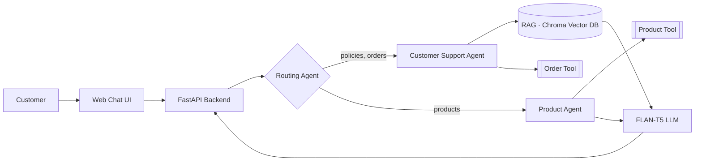

<div align="center">

# 🤖 AI Customer Support Multi-Agent System

**An intelligent support assistant that routes every customer question to the right AI agent — and grounds each answer in company knowledge.**


</div>

---

## 📌 Overview

Customer-support teams answer the same questions about orders, products and policies every day.
This project automates that work with a **multi-agent architecture**: a routing agent understands the
intent of each question and hands it to a specialised agent, which answers using **Retrieval-Augmented
Generation (RAG)** over the company's policy documents and live tool lookups over order and product data.

The system is exposed through a **FastAPI** backend and a lightweight web chat interface.

## ✨ Key Features

- **Intelligent routing** — rule-based intent detection with an LLM classifier as a fallback for ambiguous questions.
- **Customer Support Agent** — answers policy questions (shipping, returns, payment, warranty) with RAG over PDF documents.
- **Product Agent** — searches the product catalogue and recommends items that match the customer's needs.
- **Tool use** — LangChain tools for order-status lookup and product search.
- **Knowledge-grounded answers** — retrieved context is injected into the prompt to reduce hallucinations.
- **REST API + web UI** — FastAPI endpoints with a clean HTML/CSS/JS chat front end.
- **Runs locally** — uses the open-source `google/flan-t5-base` model, GPU-accelerated when available.

## 🏗️ Architecture



## 🧰 Tech Stack

| Layer | Technologies |
|---|---|
| Language | Python |
| LLM | Hugging Face Transformers · `google/flan-t5-base` · PyTorch |
| RAG | LangChain · Hugging Face Embeddings · ChromaDB · PyPDF |
| Backend | FastAPI · Pydantic · Jinja2 |
| Data | Pandas (orders & products CSV) |
| Front end | HTML · CSS · JavaScript |

## 📂 Project Structure

```text
├── app.py                     # FastAPI application & API routes
├── routing_agent.py           # Intent detection + routing logic
├── customer_support_agent.py  # Policy / order support agent
├── product_agent.py           # Product search & recommendation agent
├── rag_system.py              # Document loading, chunking, embeddings, retrieval
├── order_tool.py              # LangChain tool: order lookup
├── product_tool.py            # LangChain tool: product search
├── local_llm.py               # Shared FLAN-T5 text generator
├── index.html · style.css · script.js   # Chat interface
└── LICENSE
```

## 🚀 Getting Started

```bash
# 1. Clone the repository
git clone https://github.com/Ammarjm/ai-customer-support-multi-agent.git
cd ai-customer-support-multi-agent

# 2. Install dependencies
pip install fastapi uvicorn langchain langchain-community langchain-huggingface langchain-chroma \
            transformers torch pandas pypdf jinja2

# 3. Start the API
uvicorn app:app --reload
```

Then open **http://127.0.0.1:8000** in your browser.

## 💬 Example Questions

| Question | Routed to |
|---|---|
| *"What is your return policy?"* | Customer Support Agent (RAG) |
| *"What is the status of my order?"* | Customer Support Agent (Order Tool) |
| *"Recommend a laptop for programming"* | Product Agent |

## 🔮 Future Improvements

- Conversation memory for multi-turn dialogues
- Swappable LLM back ends (larger open-source or API models)
- Automated evaluation of answer quality and routing accuracy
- Docker deployment

## 👤 Author

**Ammar Alsabateen** — AI & Machine Learning Engineer
[GitHub](https://github.com/Ammarjm) · [Email](mailto:alsabateenammar@gmail.com)

## 📄 License

Released under the [MIT License](LICENSE).
